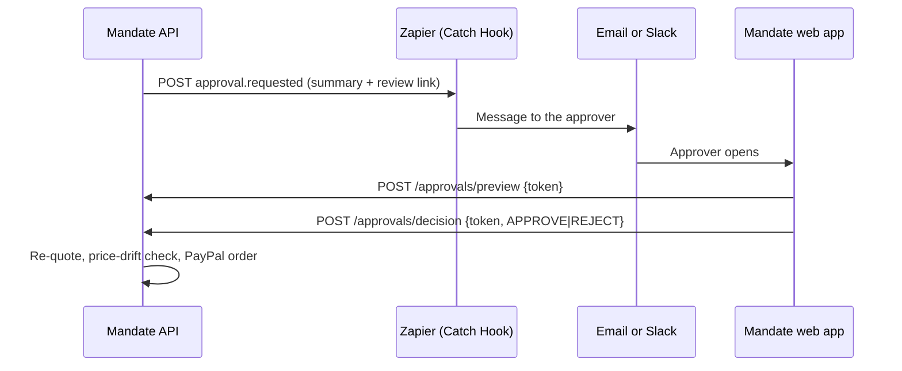

# Approvals through Zapier

When the mandate decides a cart needs a person (`NEEDS_APPROVAL`), the API asks a Zap to message the approver. The approver opens a link, sees the cart and every reason, and approves or rejects it. An approval leads to payment only after the price is checked again.



## What the Zap receives

```json
{
  "event": "approval.requested",
  "approvalId": "…",
  "purchaseId": "…",
  "amountMinor": 32399,
  "currency": "USD",
  "amountDisplay": "$323.99",
  "expiresAt": "2026-11-06T10:00:00.000Z",
  "reasons": [{ "code": "THRESHOLD_EXCEEDED", "message": "The cart total is at or above the approval threshold." }],
  "reviewUrl": "https://<web app>/#/approve/<single-use token>"
}
```

There are no API keys in the payload. The review link is the approver's credential:

- **Single use.** A second decision is refused (409).
- **Expires** with the budget hold, after 24 hours.
- **Stored as a hash.** Only its SHA-256 is kept.
- **Kept out of servers' logs.** It sits in the URL fragment, which browsers never send to a server, and the page sends it only in request bodies. The page also removes it from the address bar as soon as it has read it.

Zapier and the message service do see the link, so treat approval messages like any password-reset email.

## Set up the Zap

`VERIFY` the exact labels in Zapier's editor; these steps were written without a Zapier account at hand.

1. **Create a Zap.**
   - **Trigger:** *Webhooks by Zapier*, event *Catch Hook*.
   - Copy the hook URL. It starts with `https://hooks.zapier.com/`.
2. **Set the API's variables:**
   - `ZAPIER_APPROVAL_WEBHOOK_URL`: the hook URL. Treat it as a secret: anyone holding it can post to the Zap.
   - `WEB_APP_URL`: the web app's public URL, for example `https://mandate-web.onrender.com`. Use `http://localhost:5173` locally.
   
   On Render, both are `sync: false` in `render.yaml`.
3. **Send a sample.** Submit a request that needs approval, for example a 27-inch monitor, a conference speakerphone and a wireless keyboard (over the 300.00 threshold). The Zap's trigger test should show the fields above.
4. **Action:** *Email by Zapier* (or Gmail, or Slack *Send Channel Message*) to the approver:
   - **Subject:** `Approve {{amountDisplay}}?`
   - **Body:** the reasons' `message` fields, `expiresAt`, and `reviewUrl` as the link.
5. **Turn the Zap on.**

## When the Zap is missing or down

- **Not configured.** Without both variables the API starts normally and logs `feature disabled: configuration missing` with the variable names. Approvals then wait until they expire, and the sweep releases the budget hold.
- **Zapier fails or times out** (10 s). The request stays `PENDING_APPROVAL` and the audit log records `approval.notify_failed`. Nothing is paid.

**Not built yet:** approve and reject buttons on the dashboard. Without sign-in, anyone who can open the dashboard could press them. They need authentication first (#10 follow-up).
